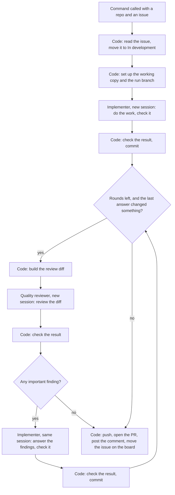

# The implementation loop

A blueprint, written to build from before the code exists. Once the code is built, it's retired,
and the status above says so.

It shows how the items in `docs/functional-spec.md` and `docs/technical-spec.md` fit together in
one run, so the builder can see the whole loop before building any part of it. Each step cites the
items it carries out. Where this blueprint and a spec disagree, the spec wins.

## A run, step by step

A step below is code or a role (AD-2). The workflow starts every role (AD-3), and is the only
part that reads or writes GitHub (AD-7).

1. **Start.** The owner calls the command with a project's repo and an issue number (FR-1). The
   workflow reads the project's settings after setup, from the run branch (FR-4, FR-6), as
   "Settings" below says.
2. **Read the issue.** The workflow reads the issue's body from GitHub, and moves the issue to In
   development, as "The board" below says.
3. **Set up.** The workflow keeps one clone of each project's repo on the machine it runs on, and
   makes it on the project's first run. For each run, it adds a new git worktree from that clone,
   as the working copy. The run branch starts from the project's default branch, and is named
   `factory/issue-<number>`.
4. **The work.** The workflow starts the implementer in a new session, with the issue's body
   (FR-2, TR-11). The implementer does the work, checks its own change, and fixes the problems its
   change caused (TR-12, TR-13). It hands back its result as structured output (TD-1).
5. **Commit.** The workflow checks the result against the implementer's result schema (TR-1). It
   commits, with the message from the result (TD-7, TD-9, TD-8).
6. **The rounds.** The first round starts when the work is committed (FR-8). Each round has
   these steps, and the next round starts when one ends and rounds are left (FR-10):
   1. **Review diff.** The workflow builds the round's review diff. In the first round, it's
      everything from where the run branch started to the latest commit (TR-3). In a later round,
      it's from the commit the previous round reviewed to the latest commit (TR-4).
   2. **Review copy.** The workflow builds the round's review copy (TD-2) in a new folder. It
      copies in the files as they stood at the commit the review diff starts from, commits them
      with a plain message such as "base", and then copies in the files at the latest commit
      without committing them.
   3. **Review.** The workflow starts the quality reviewer in a new session, in the review copy
      (TR-6). It gives the reviewer the issue's body, the review diff, and the findings from
      earlier rounds, with each declined finding marked as declined and no reason (TR-7, TR-10).
      It names the changes not yet committed as the review target in the reviewer's prompt,
      which "The quality reviewer's prompt" below describes. The reviewer reviews them, then
      hands back the findings and the dropped candidates in its result schema. When the review is done, the workflow
      removes the review copy.
   4. **Check.** The workflow checks the reviewer's result against its result schema (TR-1).
      When the reviewer stopped because it couldn't get the review diff, the workflow ends the
      run, as for a result that doesn't fit its schema. When the result has no important finding,
      this round is the run's last, and it ends here (FR-24).
   5. **Answer.** The workflow resumes the implementer's session (TD-3), and gives it the round's
      important findings and nits (FR-23). The implementer fixes each one or declines it with a
      reason (FR-9), checks its change (TR-12, TR-13), and hands back its result. When its answer
      changes nothing, this round is the run's last (TR-5).
   6. **Commit.** As in step 5.
7. **The PR.** When the last round ends, the workflow pushes the run branch and opens the PR
   (FR-15). The PR's title is the issue's title. Its description holds `Closes #<number>`, which the
   workflow writes (FR-16, TD-6), the text from the implementer's last result (TD-4), and the
   declined findings the workflow kept from every round (TD-5). The workflow posts one comment on
   the PR, with a part for each of these lists from every round: the nits and pre-existing
   findings the implementer didn't get (FR-25), the findings to check (FR-30), and the dropped
   candidates (FR-31). It then moves the issue on the board, as "The board" below says.

**When a step fails.** When a role hands back no result, or one that doesn't fit its schema, the
workflow ends the run (TR-2). So does a role that reaches its turn cap (FR-7), and a reply from
GitHub that doesn't fit its schema (TR-15). The Agent SDK's `max_turns` option sets the cap, and a
role that reaches it ends with an error result and no structured output. A run that ends without a
PR moves the issue to Needs attention, with a comment that gives the reason (FR-14).

## What each role gets and hands back

| | Implementer | Quality reviewer |
|---|---|---|
| Session | One for the whole run, resumed each round (TD-3) | A new one each round (TR-6) |
| Gets | The issue's body, then each round's important findings and nits | The issue's body, the review diff, earlier findings |
| Can use | The working copy, web search and web fetch (TR-11) | The review copy (TD-2) |
| Changes | The working copy | Nothing |
| Hands back | The text for the PR's description and a commit message | The round's findings and dropped candidates |

The implementer's result holds:

- a summary of the changes (FR-17)
- the findings it declined this time, and their reasons (FR-18, TD-5)
- doc and code disagreements (FR-19)
- choices on open points (FR-20)
- decisions with no reason (FR-21)
- the commit message (TD-9)

The quality reviewer's result holds:

- whether it reviewed the diff or stopped, with a sentence on why
- its findings
- its dropped candidates, a list the schema requires even when it's empty

Each finding holds:

- an ID, so the implementer's result can name the findings it declined
- the file and line
- the problem, and for a finding to check, what to check and how
- a concrete case where it goes wrong
- its label from the review rubric, and why that label fits
- the mark FR-27 gives it

Each dropped candidate holds its file and line, what it claimed, its label, and the reason it was
dropped.

Both roles use Opus (AD-8), and learn the project's rules from its docs (AD-9).

## What a role is allowed to do

Each role is its own agent, so the workflow sets its tools and permissions when it starts it.

- **The implementer** gets the tools to read, search, edit and run commands, plus web search and
  web fetch (TR-11).
- **The quality reviewer** gets the tools to read, search and run commands, and no tool that edits.
- **Every role** is denied the shell commands `gh` and `git push` by its permission rules (AD-7),
  and `git commit` too (TD-7). It starts with no GitHub token in its environment. A shell can still
  get around these, as AD-7's accepted gap says, until roles run in containers (#10).
- **Setup and cleanup.** When a run starts, the workflow deletes the run branch an earlier run on
  the issue left (TR-9). When a run ends, it removes the run's worktree (TR-8). The branch stays
  in the clone until the next run on the issue, so the owner can look at the work of a run that
  ended without a PR.

## The board

The workflow shows what FR-11, FR-28, FR-29 and FR-13 call for by moving the issue to a status on
the project's board:

| When | Status | Meets |
|---|---|---|
| A run starts | In development | FR-11 |
| A run opens its PR, and no review reported a finding to check | In review | FR-28 |
| A run opens its PR, and a review reported a finding to check | Needs attention | FR-29 |
| A run ends without a PR | Needs attention | FR-13 |

When an issue is in Needs attention with its PR open, the owner checks each finding to check in an
interactive session, makes any changes it calls for, and moves the issue to In review.

Each requirement's wording picks out one status, so the code holds this table as it is, in one
place. Each status's name and description go in the factory's own config, with its default
settings (see "Settings" below). A status's description says what the requirement in its row calls
for the board to show. That config is the one place the statuses are defined. The code names each
status by its key there, and a board's statuses are set from it, descriptions included. Agents in
a project read the statuses from the board, since the project's repo doesn't hold the factory's
config.

## Settings

The factory has a default for every setting: the number of rounds is 3 (FR-4), and each role has a
turn cap (FR-6), 100 turns for each role to start with. A turn cap counts each time a role is
started or resumed, as the Agent SDK's `max_turns` option does. The command refuses a number of
rounds below 1 (FR-5), and any setting that isn't valid (FR-26). A project can set any of them in a
config file in its repo. When the file, or a setting in it, is missing, the workflow uses the
default.

## The quality reviewer's prompt

The prompt is in `src/software_factory/prompts/quality-reviewer.md`. It starts from road-trip-agent's
reviewer (AD-11), the `review-pr` skill in that repo's `.claude/skills/review-pr/SKILL.md`. It labels
each finding with the review rubric in `docs/standards/review-rubric.md`, which starts from
road-trip-agent's `design/review-rubric.md`. It keeps the skill's angles A to C, and its step that
checks each candidate against the code, then labels it. It changes the skill in these ways:

- **It checks fit for use only:** whether the code works. It leaves out the skill's angle D and its
  reading of the task and the design docs. Whether the work meets its acceptance criteria and
  follows the project's design is the purpose reviewer's check, and whether the code does what the
  docs say is the doc reviewer's. The rubric says which facts it still reads the docs for.
- **Its result lists every dropped candidate,** with the reason, in a field the result schema
  requires, even when the list is empty. Road-trip-agent's reviewer dropped candidates it judged
  false without returning them, though its skill said to, so nobody could check those calls.
- **It reviews the target its caller names,** on a line at the top of the prompt, in place of the
  skill's steps for reading the PR. The workflow names the changes not yet committed in the review
  copy (TD-2). Run by hand, the same prompt can review another target, such as a branch against
  `main`.
- **It doesn't read GitHub** (AD-7). The workflow gives it the issue's body and the earlier
  findings, with each declined finding marked (TR-7, TR-10), in place of the skill's script that
  reads them from the PR. So the rubric has no label for work handed to another issue, since the
  reviewer can't read that issue.
- **Its rubric works for any project.** The labels that hang on one project, such as the threat
  model, point to the project's own docs.

## The Agent SDK

- **Tests in a review copy.** Until roles run in containers that bundle a project's dependencies
  (#10), a review copy starts with none installed.
- **Structured output on a resumed session works.** A spike with `claude-agent-sdk` 0.2.187 for
  Python resumed a session with a new schema, the same schema, and none. The session ID stayed
  the same, and the agent kept its context. The SDK's docs don't say this, so check it again on a
  later SDK version.
- **The SDK can report success with no result.** A role can end without a valid structured
  output. The result message then has `subtype: "success"` and `is_error: false`, but
  `structured_output` is `null`. The code that reads a role's result treats that as no result
  (TR-2). Its home is a comment on that code, with a test that uses a saved response showing it.

## From the sources

- **The ideation doc,** `docs/research/agentic-development-loop-ideation.html`. Its "How it runs"
  calls this shape a workflow, after Anthropic's "Building Effective Agents": the steps are known
  up front, and the inner loop is evaluator-optimizer, where one model does the work, another
  judges it, and the two repeat. Its "Who does what" and "When things go wrong" cover the parts
  this version leaves out.
- **road-trip-agent's code review,** in its `design/code-review.md`. Its reviewer hands back
  findings as JSON checked against a schema, and code posts them. Its reviewer was its own
  prompt, built from the stock prompt at `high` and tuned for that project, with a rubric of its
  own. The factory's starts from that reviewer and rubric, made to work for any project (AD-11). It gets a list of its earlier
  findings, and doesn't raise one twice. When every finding was fixed, one PR went seven rounds,
  since each fix gave the next review new lines to find things in. Its fixer confirms a finding
  against the code before fixing it, and checks a suggested fix before applying it.
