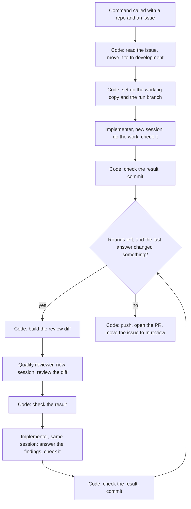

# The implementation loop

A blueprint, written to build from before the code exists. Once the code is built, it's retired,
and the status above says so.

It shows how the items in `docs/functional-spec.md` and `docs/technical-spec.md` fit together in
one run, so the builder can see the whole loop before building any part of it. Each step cites the
items it carries out. Where this blueprint and a spec disagree, the spec wins.

## A run, step by step

A step below is code or a role (AD-4). The workflow starts every role (AD-3), and is the only
part that reads or writes GitHub (AD-5).

1. **Start.** The owner calls the command with a project's repo and an issue number (FR-1). The
   workflow reads the project's settings after setup, from the run branch (FR-6, FR-27), as
   "Settings" below says.
2. **Read the issue.** The workflow reads the issue's body from GitHub, and moves the issue to In
   development, as "The board" below says.
3. **Set up.** The workflow keeps one clone of each project's repo on the machine it runs on, and
   makes it on the project's first run. For each run, it adds a new git worktree from that clone,
   as the working copy. The run branch starts from the project's default branch, and is named
   `factory/issue-<number>`.
4. **The work.** The workflow starts the implementer in a new session, with the issue's body
   (FR-5, TR-11). The implementer does the work, checks its own change, and fixes the problems its
   change caused (TR-8, TR-9). It hands back its result as structured output (TD-7).
5. **Commit.** The workflow checks the result against the implementer's result schema (TR-1). It
   commits, with the message from the result (TD-8, TD-9, TD-10).
6. **The rounds.** The first round starts when the work is committed (FR-23). Each round has
   these steps, and the next round starts when one ends and rounds are left (FR-7):
   1. **Review diff.** The workflow builds the round's review diff. In the first round, it's
      everything from where the run branch started to the latest commit (TR-2). In a later round,
      it's from the commit the previous round reviewed to the latest commit (TR-3).
   2. **Review copy.** The workflow builds the round's review copy (TD-13) in a new folder. It
      copies in the files as they stood at the commit the review diff starts from, commits them
      with a plain message such as "base", and then copies in the files at the latest commit
      without committing them.
   3. **Review.** The workflow starts the quality reviewer in a new session, in the review copy
      (TR-14). It gives the
      reviewer the issue's body, the review diff, and the findings from earlier rounds, with each
      declined finding marked as declined and no reason (TR-4, TR-12). Its prompt tells it to
      run Claude Code's stock code review on the changes not yet committed (AD-15), then hand back
      the findings in its result schema. When the review is done, the workflow removes the review
      copy.
   4. **Check.** The workflow checks the reviewer's result against its result schema (TR-1).
   5. **Answer.** The workflow resumes the implementer's session (TD-3), and gives it the round's
      findings. The implementer fixes each finding or declines it with a reason (FR-24), checks its
      change (TR-8, TR-9), and hands back its result. When its answer changes nothing, this round
      is the run's last (TR-16).
   6. **Commit.** As in step 5.
7. **The PR.** When the last round ends, the workflow pushes the run branch and opens the PR
   (FR-15). The PR's title is the issue's title. Its description holds `Closes #<number>`, which the
   workflow writes (FR-16, TD-6), the text from the implementer's last result (TD-4), and the
   declined findings the workflow kept from every round (TD-12). The workflow moves the issue to In
   review.

**When a step fails.** When a role hands back no result, or one that doesn't fit its schema, the
workflow ends the run (TR-13). So does a role that reaches its turn cap (FR-28). The Agent SDK's
`max_turns` option sets the cap, and a role that reaches it ends with an error result and no
structured output. A run that ends without a PR moves the issue to Needs attention, with
a comment that gives the reason (FR-12).

## What each role gets and hands back

| | Implementer | Quality reviewer |
|---|---|---|
| Session | One for the whole run, resumed each round (TD-3) | A new one each round (TR-14) |
| Gets | The issue's body, then each round's findings | The issue's body, the review diff, earlier findings |
| Can use | The working copy, web search and web fetch (TR-11) | The review copy (TD-13) |
| Changes | The working copy | Nothing |
| Hands back | The text for the PR's description and a commit message | The round's findings |

The implementer's result holds:

- a summary of the changes (FR-17)
- the findings it declined this time, and their reasons (FR-18, TD-12)
- doc and code disagreements (FR-19)
- choices on open points (FR-26)
- decisions with no reason (FR-22)
- the commit message (TD-9)

Each finding in the quality reviewer's result holds:

- an ID, so the implementer's result can name the findings it declined
- the file and line
- the problem
- a concrete case where it goes wrong

Both roles use Opus (AD-6), and learn the project's rules from its docs (AD-12).

## What a role is allowed to do

Each role is its own agent, so the workflow sets its tools and permissions when it starts it.

- **The implementer** gets the tools to read, search, edit and run commands, plus web search and
  web fetch (TR-11).
- **The quality reviewer** gets the tools to read, search and run commands, and no tool that edits.
- **Every role** is denied the shell commands `gh` and `git push` by its permission rules (AD-5),
  and `git commit` too (TD-8). It starts with no GitHub token in its environment. A shell can still
  get around these, as AD-5's accepted gap says, until roles run in containers (#10).
- **Setup and cleanup.** When a run starts, the workflow deletes the run branch an earlier run on
  the issue left (TR-18). When a run ends, it removes the run's worktree (TR-17). The branch stays
  in the clone until the next run on the issue, so the owner can look at the work of a run that
  ended without a PR.

## The board

The workflow shows what FR-9, FR-10 and FR-11 call for by moving the issue to a status on the
project's board:

| When | Status | Meets |
|---|---|---|
| A run starts | In development | FR-9 |
| A run opens its PR | In review | FR-10 |
| A run ends without a PR | Needs attention | FR-11 |

The statuses and what each means are set up with the board, under #71. Each requirement's wording
picks out one status, so the code holds this table as it is, in one place.

## Settings

The factory has a default for every setting: the number of rounds is 3 (FR-6), and each role has a
turn cap (FR-27), 100 turns for each role to start with. A turn cap counts each time a role is
started or resumed, as the Agent SDK's `max_turns` option does. The command refuses a number of
rounds below 1 (FR-29). A project can set any of them in a config file in its repo. When the file,
or a setting in it, is missing, the workflow uses the default.

## The Agent SDK

- **Check the stock code review first.** Before building the review copy (TD-13), confirm in a
  spike that, run by a role started from the Agent SDK, Claude Code's stock code review:
  - reviews the changes not yet committed when it's given no target
  - leaves the role able to hand back its findings as structured output (TD-7)
- **Tests in a review copy.** Until roles run in containers that bundle a project's dependencies
  (#10), a review copy starts with none installed.
- **Structured output on a resumed session works.** A spike with `claude-agent-sdk` 0.2.187 for
  Python resumed a session with a new schema, the same schema, and none. The session ID stayed
  the same, and the agent kept its context. The SDK's docs don't say this, so check it again on a
  later SDK version.
- **The SDK can report success with no result.** A role can end without a valid structured
  output. The result message then has `subtype: "success"` and `is_error: false`, but
  `structured_output` is `null`. The code that reads a role's result treats that as no result
  (TR-13). Its home is a comment on that code, with a test that uses a saved response showing it.

## From the sources

- **The ideation doc,** `docs/research/agentic-development-loop-ideation.html`. Its "How it runs"
  calls this shape a workflow, after Anthropic's "Building Effective Agents": the steps are known
  up front, and the inner loop is evaluator-optimizer, where one model does the work, another
  judges it, and the two repeat. Its "Who does what" and "When things go wrong" cover the parts
  this version leaves out.
- **road-trip-agent's code review,** in its `design/code-review.md`. Its reviewer hands back
  findings as JSON checked against a schema, and code posts them. Its reviewer was its own,
  tuned for that project, where the factory's is stock (AD-15). It gets a list of its earlier
  findings, and doesn't raise one twice. When every finding was fixed, one PR went seven rounds,
  since each fix gave the next review new lines to find things in. Its fixer confirms a finding
  against the code before fixing it, and checks a suggested fix before applying it.
