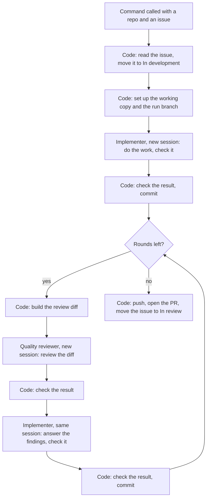

# The implementation loop

A blueprint, written to build from before the code exists. Once the code is built, it's retired,
and the status above says so.

It shows how the items in `docs/functional-spec.md` and `docs/technical-spec.md` fit together in
one run, so the builder can see the whole loop before building any part of it. Each step cites the
items it carries out. Where this blueprint and a spec disagree, the spec wins.

## A run, step by step

A step below is code or a role (AD-4). The workflow starts every agent (AD-3), and is the only
part that reads or writes GitHub (AD-5).

1. **Start.** The owner calls the command with a project's repo and an issue number (FR-1). The
   workflow works out the run's number of rounds (FR-6).
2. **Read the issue.** The workflow reads the issue's body from GitHub, and moves the issue to In
   development on the board (FR-9).
3. **Set up.** The workflow makes the working copy and the run branch.
4. **The work.** The workflow starts the implementer in a new session, with the issue's body
   (FR-5, TR-11). The implementer does the work, checks its own change, and fixes the problems its
   change caused (TR-8, TR-9). It hands back its result as structured output (TD-7).
5. **Commit.** The workflow checks the result against the implementer's result schema (TR-1). It
   commits, with the message from the result (TD-8, TD-9, TD-10).
6. **The rounds.** The first round starts when the work is committed (FR-23). Each round has
   these steps, and the next round starts when one ends and rounds are left (FR-7):
   1. **Review diff.** The workflow builds the round's review diff. In the first round, it's
      everything from where the run branch started to the latest commit (TR-2). In a later round,
      it's from the commit the previous round reviewed to the latest commit (TR-3).
   2. **Review.** The workflow starts the quality reviewer in a new session (TR-14). It gives the
      reviewer the issue's body, the review diff, and the findings from earlier rounds, with each
      declined finding marked as declined and no reason (TR-4, TR-12). The reviewer reads the docs
      and code in the working copy, changes nothing (TR-5), and hands back its findings.
   3. **Check.** The workflow checks the reviewer's result against its result schema (TR-1).
   4. **Answer.** The workflow resumes the implementer's session (TD-3), and gives it the round's
      findings. The implementer fixes each finding or declines it with a reason (FR-24), checks its
      change (TR-8, TR-9), and hands back its result.
   5. **Commit.** As in step 5.
7. **The PR.** When the last round ends, the workflow pushes the run branch and opens the PR
   (FR-15). The PR's description holds `Closes #<number>`, which the workflow writes (FR-16,
   TD-6), and the text from the implementer's result (TD-4). The workflow moves the issue to In
   review (FR-10).

**When a step fails.** When a role hands back no result, or one that doesn't fit its schema, the
workflow ends the run (TR-13). A run that ends without a PR moves the issue to Needs attention
(FR-11), with a comment that gives the reason (FR-12).

## What each role gets and hands back

| | Implementer | Quality reviewer |
|---|---|---|
| Session | One for the whole run, resumed each round (TD-3) | A new one each round (TR-14) |
| Gets | The issue's body, then each round's findings | The issue's body, the review diff, earlier findings |
| Can use | The working copy, web search and web fetch (TR-11) | The docs and code in the working copy (TR-4) |
| Changes | The working copy, the only role that does (TR-5) | Nothing |
| Hands back | The text for the PR's description and a commit message | The round's findings |

The implementer's result holds:

- a summary of the changes (FR-17)
- the declined findings and their reasons (FR-18)
- doc and code disagreements (FR-19)
- choices on open points (FR-26)
- decisions with no reason (FR-22)
- the commit message (TD-9)

Both roles use Opus (AD-6), and get their guidance from the project's docs (AD-12).

## The Agent SDK

- **Structured output on a resumed session works.** A spike with `claude-agent-sdk` 0.2.187 for
  Python resumed a session with a new schema, the same schema, and none. The session ID stayed
  the same, and the agent kept its context. The SDK's docs don't say this, so check it again on a
  later SDK version.
- **The SDK can report success with no result.** A role can end without a valid structured
  output. The result message then has `subtype: "success"` and `is_error: false`, but
  `structured_output` is `null`. The code that reads a role's result treats that as no result
  (TR-13). Its home is a comment on that code, with a test that uses a saved response showing it.

## From the sources

- **The ideation doc,** `docs/research/agentic-development-loop-ideation.html`. Its "How it runs"
  calls this shape a workflow, after Anthropic's "Building Effective Agents": the steps are known
  up front, and the inner loop is evaluator-optimizer, where one model does the work, another
  judges it, and the two repeat. Its "Who does what" and "When things go wrong" cover the parts
  this version leaves out.
- **road-trip-agent's code review,** in its `design/code-review.md`. Its reviewer hands back
  findings as JSON checked against a schema, and code posts them. It gets a list of its earlier
  findings, and doesn't raise one twice. When every finding was fixed, one PR went seven rounds,
  since each fix gave the next review new lines to find things in. Its fixer confirms a finding
  against the code before fixing it, and checks a suggested fix before applying it.
