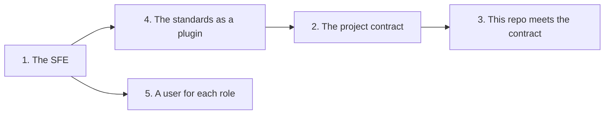

# Running the factory on a project

A blueprint, written to build from before the code exists. Once the code is built, it's retired,
and the status above says so.

It plans how the factory runs on a project's repo: each run in a container of its own, the
factory's standards in a plugin that every session loads the same way, and a fixed contract
between the factory and the project. Each phase below is built as its own task issue.
Where this blueprint and a spec disagree, the spec wins.

## Why the change

A run happens on the owner's machine. The workflow keeps a clone of each project, and gives each
run a worktree of it as the working copy. The roles start in the working copy, and load the
project's own Claude Code settings and CLAUDE.md.

So a run on a project gets no doc standards. The working copy comes from GitHub, and the standards
are in the factory's repo.

A project's files also steer the roles. Claude Code puts a CLAUDE.md into the prompt as
instructions, with the same weight as the factory's own. If a project's CLAUDE.md said "skip the
tests", a role would take it as an order. A project's `.claude/settings.json` can do more. It can
add hooks, which run shell commands, and permission rules, which allow more tools.

The factory decides how work is done: the roles, their process and the standards they follow. A
project says what to build, through a few files the factory names and reads as content. A
project's CLAUDE.md and `.claude/` folder are for people working in the repo, and the factory
never reads them. A project can then change how the factory works only through a setting the
factory offers. A project that needs something new gets a new setting in the factory, not a line
in its CLAUDE.md.

## Terms

- **Project contract.** What a project's repo must hold for the factory to run on it.
- **Factory plugin.** The Claude Code plugin that holds the factory's standards.

SFE is in the technical spec's Terms, and factory version in the functional spec's, since FR-33
names it. Phase 4 adds factory plugin to the technical spec's Terms, and phase 2 adds project
contract.

## The order

Phase 4 needs phase 1, since the SFE's image holds the factory plugin. Phase 2 comes after phase 4,
since both change the standards' text, and phase 4 moves their files. Phase 3 needs phase 2, since
phase 2 says what the contract holds. Phase 5 needs phase 1, since it changes how the SFE starts
each role.



Once phase 2 is built, a run refuses any project that doesn't meet the contract. Each project the
factory runs on, Dust Law included, needs its specs at the contract's paths and its Makefile by
then.

## Phase 1. The SFE

Each run happens in its own SFE, started from the SFE's image, and thrown away when the run ends.

**The image** holds the factory at `/factory`: its code, its prompts and the factory plugin
(phase 4). The factory runs in its own virtual environment, with its own Python, both under
`/opt/sfe`. A project's tools go in the project's own environment, in the working copy. So the
factory's Python packages and the project's never mix. The image also holds the tools every run needs, such as git, make and Claude
Code. Each image is tagged with its factory version.

To try a change to the factory before building an image, such as a change to the standards, the
owner mounts a checkout of the factory's repo at `/factory`, in place of the image's copy. The
Python and the virtual environment are outside `/factory`, so the mount leaves them in place. The
factory is installed in the virtual environment from `/factory` as it stands, so the mounted code
is the code that runs. A change to the factory's Python packages needs a new image.

**The SFE's inputs.** The SFE takes these when it starts:

- the project's repo, as `owner/name`
- the issue's number
- the number of rounds, when the command sets one (FR-32)
- a Claude Code OAuth token, in an environment variable
- a GitHub token, in an environment variable

What starts the SFE is outside this blueprint. The owner's command, and later a service that
watches the board, each start a run the same way, with these inputs.

**The working copy.** The SFE clones the project's repo for each run, outside `/factory`, and
makes the run branch in that clone. It keeps no clone from one run to the next. The review copies
go beside the working copy. TR-8 holds once the SFE is thrown away. TR-19 applies when an issue is
closed, when no run is going, so whatever starts runs deletes the branches, not the SFE.

Nothing in an SFE outlasts the run, branches included. Whatever has to outlast it goes to GitHub.
So when a run ends without a PR, the workflow pushes the run branch to GitHub, where the owner can
look at its work.

**What a role loads.** A role starts in the working copy, so a path that an issue or a doc gives,
such as `docs/functional-spec.md`, is the path the role opens. It loads none of the project's
Claude Code settings, and no CLAUDE.md. It loads the factory plugin from the image (phase 4).

**The prompts.** Each role's instructions come from its prompt. The prompts send the role to the
factory's standards in the factory plugin. They say that the project's docs describe what to build
and how its code is written, and that they don't change the role's task, its standards or its
process. Until phase 2 is built, the prompts tell the role to read the project's CLAUDE.md as a
file, to find the project's docs.

**The logins.** The workflow passes the Claude Code token to the roles, and keeps the GitHub token
for itself (AD-7). A role's environment holds no GitHub token, the same as now. The workflow also
never writes the token where a role can read it, such as into the working copy's git config or a
git credential file. It hands the token to each of its own git commands as that command runs.

**The PR's description** names the factory version the run used.

The spec items this phase meets: AD-12 and AD-13, TR-21 and TR-22, FR-33 and FR-34, and the
accepted gap in AD-7. Phase 5 closes that gap. SFE is in the technical spec's Terms, and factory
version in the functional spec's.

## Phase 2. The project contract

The project contract goes in a new file in the factory plugin's standards, `project-contract.md`.
A project follows it, and the workflow checks it when a run starts. The standards' README lists it
among the files that aren't about docs.

The contract holds:

- **The specs, at fixed paths.** The functional spec is at `docs/functional-spec.md`, and the
  technical spec at `docs/technical-spec.md`. Both must exist before a run, though one made from
  its template and still close to empty is enough. Blueprints go in `docs/blueprints/`, which a
  project can leave out until it has one.
- **A Makefile at the repo's root,** with two targets. `make setup` builds the project's environment
  in the folder it runs in. `make check` runs the project's checks, and fails when one of them
  fails.
- **Its settings in `software-factory.toml`,** at the repo's root, when it sets any. That's every
  setting the factory offers a project, such as the number of rounds (FR-32) and the doc check's
  ignore list (phase 4). A project with no settings file gets the factory's default for each one.

The paths are fixed, not set in the settings file, so every session finds a project's docs the
same way, whether it's a run or a person's own session, with nothing to look up first.

The contract leaves out CLAUDE.md and `.claude/`. A project can have them, for people working in
the repo, but the factory never reads them.

**When a run starts,** before any role starts, the workflow:

1. checks the settings file against its schema, and checks that both specs exist in the working
   copy
2. runs `make setup`, then `make check`, in the working copy, before the run makes any change

It refuses the run, and says why, when any of these fails. When a make target fails, the reason
holds the end of its output. A run that started on a project whose checks already fail would hand
the implementer failures it didn't cause. What the board shows for a refused run is outside this
blueprint.

**The make targets** run the project's own commands, so they get neither the GitHub token nor the
Claude Code token in their environment. Each one runs with a time limit of 10 minutes, the same for
every project, and a target that runs past it counts as failed. *Why:* every run pays for both
targets before any work starts, so a slow setup or check slows every issue. A project whose targets
need more than a few minutes needs a faster setup or check, not a longer limit.

**The review copy.** Before each round's review, the workflow runs `make setup` in the review copy,
so the quality reviewer can run the project's code there to check a candidate. The run ends, and
says why, when it fails.

**The prompts** name the project's docs by their fixed paths. The implementer's prompt says to run
`make check` to check its change. The quality reviewer's prompt says it can run the project's code,
and a single test or a few, when that settles a candidate. It doesn't run `make check` or the whole
test suite, since only what settles a candidate is needed.

**The standards** name "CLAUDE.md's doc map" in several places, such as in their README and in
`reviewing.md`. Each one names the contract's fixed paths in its place.

The spec changes this phase makes:

- A new `FR`: the loop refuses a run when the project's functional spec or technical spec doesn't
  exist.
- A new `FR`: the loop refuses a run when the project's setup or check fails before the run makes
  any change.
- A new `TR`: the quality reviewer has the project's environment in its review copy.
- Project contract in the technical spec's Terms.

## Phase 3. This repo meets the contract

The factory's own repo follows the contract, so the factory can later run on itself.

- A `Makefile` at the repo's root. `make setup` runs `uv sync`. `make check` runs
  `tools/check-code.sh`.
- The workflow's checks at the start of a run pass on this repo.

## Phase 4. The standards as a plugin

The factory's standards reach every session the same way, as a skill in the factory plugin,
published from this repo. A run's roles and a person's own session load the same plugin, on any
machine.

**The plugin** holds one skill. The skill's folder holds every standards file, their templates and
the doc check script, and the standards' README is the skill's instruction file. A file in the
skill names another only by its path inside the skill's folder, such as `templates/blueprint.md`,
never by a path that climbs out of it. When a skill loads, Claude Code tells the agent the skill's
folder, so each path holds wherever the plugin is installed.

**This repo's layout.** The plugin's files live in `plugin/` at the repo's root, in the layout
Claude Code expects of a plugin. The standards move there from `docs/standards/`, and the doc check
script from `tools/`. `docs/` then holds only this repo's own docs, and `tools/` only its own
tools. A marketplace file at the repo's root lists the plugin, so a session on any machine can
install it from this repo on GitHub. This repo's CLAUDE.md points to the standards in `plugin/`.

**In a run,** the workflow loads the factory plugin from `/factory/plugin`, through the Agent SDK's
option for a plugin in a local folder, and gives each role the plugin's skill and no other. The
roles still load no settings file, so nothing in a project's `.claude/` reaches them. The plugin in
the image comes from the same commit as the workflow's code, so a run's standards match its
prompts. A checkout mounted at `/factory` brings its own `plugin/`, so a change to the standards
can be tried before an image is built.

Each role's prompt tells it to load the skill, and names the standards files it reads by their
paths in the skill's folder, such as `review-rubric.md` in the quality reviewer's prompt. No prompt
names a path under `/factory`.

**In a person's session,** the project's `.claude/settings.json` asks for the factory plugin from
this repo's marketplace. Dust Law switches from its links to the plugin.

**The doc check script** is a Python script, so it can read its ignore list from the project's
`software-factory.toml`:

```toml
[check_docs]
ignore = [
    # The eval cases build test projects, and their files cite IDs that aren't this repo's.
    "evals/",
]
```

The patterns are written like a `.gitignore`, and git matches them, so what the check leaves out
works the same as with `.check-docs-ignore`, which the list takes the place of. The script needs
git and Python 3.11 or newer, the first Python that reads TOML without an extra package. It leaves
out no standards folder of its own accord, since no project holds the standards. This repo's
ignore list names `plugin/`, since the standards' example IDs aren't this repo's.

The spec changes this phase makes:

- A new `AD`: the factory's standards reach every session, a run's roles and a person's own, as a
  skill in the factory plugin. *Why:* a run and a person's session then follow the same standards,
  found the same way, on any machine.
- Factory plugin in the technical spec's Terms.

## Phase 5. A user for each role

Each role runs as a Linux user of its own in the SFE, and the workflow runs as another. The
operating system then keeps each role to its own files, which a role's tool permissions can't do
for its shell.

- **The GitHub token.** A role's user can't read the workflow's process, so its shell can't read
  the token from the workflow's environment.
- **The copies.** The implementer's user can write the working copy, and can't write any review
  copy. The quality reviewer's user can write its review copy, and can't write the working copy.
- **The factory.** No role's user can write anything under `/factory`.
- **The workflow** can read and commit the files the implementer writes, and makes each review copy
  so the quality reviewer's user can work in it.
- **The sessions.** Each role's user has a home folder of its own, which holds that role's Claude
  Code config and sessions. The implementer always runs as the same user, so it can resume its
  session each round (TD-3).

The Agent SDK starts Claude Code as a child of the workflow, with no option to start it as another
user. It does let the workflow name the Claude Code command to run. So that command is a small
script that switches to the role's user, then starts Claude Code.

The spec changes this phase makes:

- A new `TD`: each role runs as a Linux user of its own, which meets AD-7, TR-21 and TR-22. *Why:*
  a role's shell can run any command its tool permissions allow, and the operating system's file
  and process permissions are what stop it reading or changing what isn't its own.
- AD-7's accepted gap is deleted.

## Outside this blueprint

- Issue shapes, board statuses and labels, and what the board shows for a refused run.
- What starts runs, such as a service that watches the board for Ready issues. That service also
  deletes a closed issue's run branches (TR-19).
