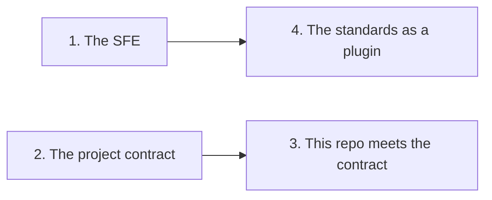

# Running the factory on a project

A blueprint, written to build from before the code exists. Once the code is built, it's retired,
and the status above says so.

It plans how the factory runs on a project's repo: each run in a container of its own, and a fixed
contract between the factory and the project. Each phase below is built as its own task issue.
Where this blueprint and a spec disagree, the spec wins.

## Why the change

A run happens on the owner's machine. The workflow keeps a clone of each project, and gives each
run a worktree of it as the working copy. The roles start in the working copy, and load the
project's own Claude Code settings and CLAUDE.md (AD-9).

So a run on a project gets no doc standards. The working copy comes from GitHub, and the standards
are in the factory's repo.

A project's files also steer the roles. Claude Code puts a CLAUDE.md into the prompt as
instructions, with the same weight as the factory's own. If a project's CLAUDE.md said "skip the
tests", a role would take it as an order. A project's `.claude/settings.json` can do more. It can
add hooks, which run shell commands, and permission rules, which allow more tools.

The factory decides how work is done: the roles, their process and the standards they follow. A
project says what to build, through a few files the factory names and reads as content. A
project's CLAUDE.md and `.claude/` folder are for people working in the repo, and the factory
never reads them. A project can then change how the factory works only through a setting the
factory offers. A project that needs something new gets a new setting in the factory, not a line
in its CLAUDE.md.

## Terms

- **SFE.** The container a run happens in. It holds the factory, and the run's copies of the
  project's repo.
- **Factory version.** The version of the SFE's image, named for the commit of the factory's repo
  the image is built from.
- **Project contract.** What a project's repo must hold for the factory to run on it.
- **Doc map.** The paths of a project's docs, in the project's settings file.

Phase 1 adds SFE and factory version to the technical spec's Terms, and phase 2 adds project
contract and doc map.

## The order

Phases 1 and 2 can be built in either order. Phase 3 needs phase 2, since phase 2 says what the
contract holds. Phase 4 needs phase 1, since phase 1 says where the standards live in a run.



Once phase 2 is built, a run refuses any project that doesn't meet the contract. Each project the
factory runs on, Dust Law included, needs its settings file and Makefile by then.

## Phase 1. The SFE

Each run happens in its own SFE, started from the SFE's image, and thrown away when the run ends.

**The image** holds the factory at `/factory`: its code, its prompts, its doc standards in
`/factory/docs/standards/`, and the doc check script at `/factory/tools/check-docs.sh`. The factory
runs in its own virtual environment, with its own Python, both under `/factory`. A project's tools
go in the project's own environment, in the working copy. So the factory's Python packages and the
project's never mix. The image also holds the tools every run needs, such as git, make and Claude
Code. Each image is tagged with its factory version.

To try a change to the factory before building an image, such as a change to the standards, the
owner mounts a checkout of the factory's repo at `/factory`, in place of the image's copy.

**The SFE's inputs.** The SFE takes these when it starts:

- the project's repo, as `owner/name`
- the issue's number
- the number of rounds, when the command sets one (FR-4)
- a Claude Code OAuth token, in an environment variable
- a GitHub token, in an environment variable

What starts the SFE is outside this blueprint. The owner's command, and later a service that
watches the board, each start a run the same way, with these inputs.

**The working copy.** The SFE clones the project's repo for each run, outside `/factory`, and
makes the run branch in that clone. It keeps no clone from one run to the next. The review copies
go beside the working copy. TR-8 holds once the SFE is thrown away. TR-19 applies when an issue is
closed, when no run is going, so whatever starts runs deletes the branches, not the SFE.

Nothing in an SFE outlasts the run, branches included. Whatever has to outlast it goes to GitHub.
So when a run ends without a PR, the workflow pushes the run branch to GitHub, where the owner can
look at its work.

**What a role loads.** A role starts in the working copy, so a path that an issue or a doc gives,
such as `docs/functional-spec.md`, is the path the role opens. It loads none of the project's
Claude Code settings, and no CLAUDE.md. A path that starts with `/factory/` is always the
factory's, and any other path is the project's.

**The prompts.** Each role's instructions come from its prompt. The prompts name the factory's
standards by their path under `/factory`, such as `/factory/docs/standards/review-rubric.md` in the
quality reviewer's prompt. They say that the project's docs describe what to build and how its code
is written, and that they don't change the role's task, its standards or its process. Until phase 2
is built, the prompts tell the role to read the project's CLAUDE.md as a file, to find the
project's docs.

**The logins.** The workflow passes the Claude Code token to the roles, and keeps the GitHub token
for itself (AD-7). A role's environment holds no GitHub token, the same as now. The workflow also
never writes the token where a role can read it, such as into the working copy's git config or a
git credential file. It hands the token to each of its own git commands as that command runs.

**The PR's description** names the factory version the run used.

The spec changes this phase makes:

- A new `AD`: each run happens in its own SFE, which is thrown away when the run ends. *Why:* the
  factory in the image stays the same for the whole run, so nothing in a project's repo can change
  how the factory works, even when the project is the factory's own repo. A project's setup can
  install whatever the project needs, and none of it outlives the run. The standards and the code
  that uses them also come in one version.
- A new `AD` in place of AD-9: a role's instructions come only from the factory, and a project's
  docs and files are content the role reads. *Why:* the factory controls how work is done, so a
  run follows a known version of its prompts and standards. If a project's files could put
  instructions into a role's prompt, a team using the factory could tell the role how to work, not
  just what to build. The project's CLAUDE.md also keeps one use, for people working in the repo.
- New items in place of TR-7 and TR-11, which add the factory's doc standards to what each role has
  access to.
- A new `FR`: the PR's description names the factory version the run used.
- A new `FR`: when a run ends without a PR, the run branch is on GitHub. *Why:* the factory can run
  on any machine, not only the owner's, so nothing kept on the machine is sure to be there later.
- SFE and factory version in the technical spec's Terms.

## Phase 2. The project contract

The project contract goes in a new standards file, `docs/standards/project-contract.md`. A project
follows it, and the workflow checks it when a run starts. The README in `docs/standards/` lists it
among the files that aren't about docs.

The contract holds:

- **A doc map in `software-factory.toml`,** the settings file at the repo's root that FR-4 and
  FR-26 already read. The doc map gives the path of the functional spec, the technical spec and the
  blueprints folder:

  ```toml
  [docs]
  functional_spec = "docs/functional-spec.md"
  technical_spec = "docs/technical-spec.md"
  blueprints = "docs/blueprints"
  ```

- **A Makefile at the repo's root,** with two targets. `make setup` builds the project's environment
  in the working copy. `make check` runs the project's checks, and fails when one of them fails.

The contract leaves out CLAUDE.md and `.claude/`. A project can have them, and its CLAUDE.md can
point to the doc map, but the factory never reads them.

**When a run starts,** before any role starts, the workflow:

1. checks the settings file against its schema, doc map included, and checks that each path in the
   doc map exists in the working copy
2. runs `make setup`, then `make check`, in the working copy, before the run makes any change

It refuses the run, and says why, when any of these fails. A run that started on a project whose
checks already fail would hand the implementer failures it didn't cause. What the board shows for a
refused run is outside this blueprint.

**The prompts** get the doc map from the workflow, under the factory's own wording. The
implementer's prompt says to run `make check` to check its change. The quality reviewer's prompt
says to run the project's tests the way `make check` does.

**The standards** name "CLAUDE.md's doc map" in several places, such as in their README and in
`reviewing.md`. Each one becomes the doc map in the project's settings file.

The spec changes this phase makes:

- A new `FR`: the loop refuses a run when the settings file has no doc map, or a path in it doesn't
  exist.
- A new `FR`: the loop refuses a run when the project's setup or check fails before the run makes
  any change.
- Project contract and doc map in the technical spec's Terms.

## Phase 3. This repo meets the contract

The factory's own repo follows the contract, so the factory can later run on itself.

- A `Makefile` at the repo's root. `make setup` runs `uv sync`. `make check` runs
  `tools/check-code.sh`.
- A `software-factory.toml` at the repo's root, with the doc map.
- The rows of CLAUDE.md's doc map for the specs and the blueprints point to the doc map in
  `software-factory.toml`. The other rows stay, for people working in the repo.

## Phase 4. The standards as a plugin

A person's own Claude Code session in a project, outside any run, gets the factory's standards from
a Claude Code plugin published from this repo. The plugin holds `docs/standards/` and
`tools/check-docs.sh`, in the same layout as `/factory`, so a path from one file to another holds in
both.

A project asks for the plugin in its `.claude/settings.json`. A run loads none of that file (phase
1), so the plugin reaches only people's sessions. The plugin and the image are built from the same
commit, so a person's session and a run follow the same standards. Dust Law switches from its
links to the plugin.

## Outside this blueprint

- Issue shapes, board statuses and labels, and what the board shows for a refused run.
- What starts runs, such as a service that watches the board for Ready issues. That service also
  deletes a closed issue's run branches (TR-19).
