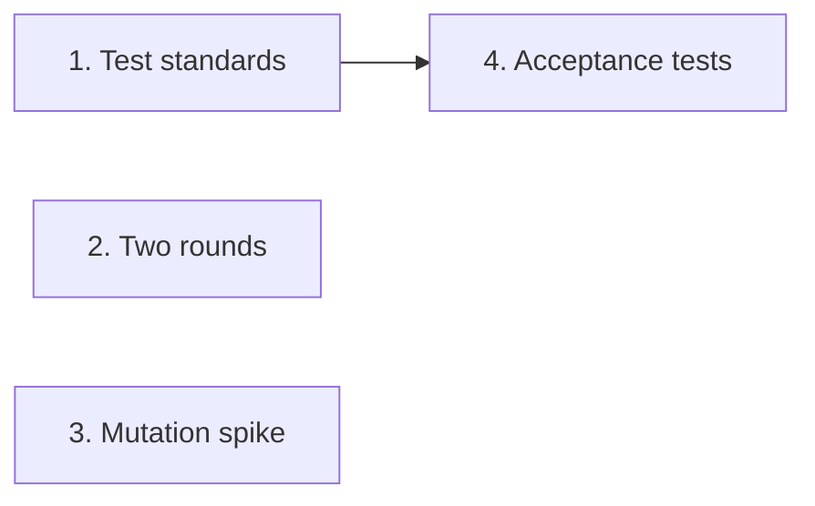
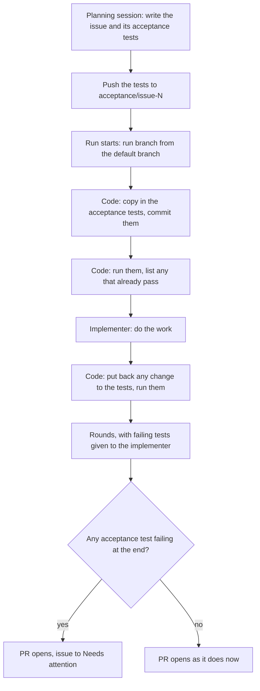

# Testing a run's work

A blueprint, written to build from before the code exists. Once the code is built, it's retired,
and the status above says so.

It plans four changes to how the implementation loop tests a run's work. Each phase below is built
as its own task issue. Where this blueprint and a spec disagree, the spec wins.

## Why the change

A test is worth its cost when its expected value comes from somewhere the code's author didn't
write. A spec item is one such place. A test written before the work is another. A test that an
agent writes after its own code copies its expected values from that code. When the agent
misreads the issue, the code and the test are wrong in the same way, and the test passes.

The loop now lets the implementer write any tests it likes. The review rubric's F6 label then asks
for more of them. In the check of the quality reviewer, F6 was 25 of its 32 important findings. So
the review rounds mostly ask the implementer for another test of the code it just wrote.

The phases below make tests point back to the specs, cut the default rounds, try mutation testing
as a check on the tests, and add acceptance tests that are written before the work.

## The order

Phases 1, 2 and 3 can be built in any order. Phase 4 needs phase 1, since `tests.md` holds the
rules for writing acceptance tests.

## Phase 1. The test standards

Add `docs/standards/tests.md`, the factory's standards for a project's tests. Each run gets the
factory's own standards folder, so the implementer and the quality reviewer read the same rules.
The factory's own code follows them too.

`tests.md` says:

- **Each test names the rule it checks.** That's the ID of a spec item, such as an `FR`, `TR`,
  `TD` or `CS`, or the bug the test guards against. For example, FR-5 says the loop refuses a run
  with fewer than 1 round. A test that passes 0 and checks for the refusal names FR-5.
- **A test with no rule to name isn't written.** A test that checks a helper returns the same list
  it returns today names nothing, so it isn't written.
- **How an acceptance test is written,** for phase 4. It's written before the work, from the
  issue's acceptance criteria. It tests from the outside, through the project's commands, API or
  files, never its internals. It names the `FR` or `TR` it checks. It fails before the work is
  done.

The rules cover each test a change adds or changes. Tests already in a repo aren't changed to name
a rule.

Then:

- **The implementer's prompt** points to `tests.md` in its steps for doing the work.
- **The review rubric's F6** narrows to behavior that a spec item or a bug fix calls for, and that
  no test checks. Behavior no spec item holds gets no finding for its missing test.
- **The quality reviewer's prompt,** where it says to look at the tests, matches the new F6.
- **The README in `docs/standards/`** lists `tests.md` among the files that aren't about docs, and
  says who reads it. The repo's `CLAUDE.md` adds it to the doc map, and says to read it before
  writing or changing a test.

## Phase 2. Two rounds by default

The factory's default number of rounds goes from 3 to 2. Round 1 reviews the work. Round 2 reviews
only the fixes, as TR-4 already has it.

- Replace FR-4 with a new item whose default is 2. A different default changes the item's meaning,
  so it gets a new ID.
- Set `rounds = 2` in `factory.toml`, and change the tests that check the default.

Why 2: Joe, "Maybe 2 rounds is fine, 1 for the fix and then 1 for reviewing the fixes." LLM
reviewers also mostly find the same bugs as each other, so a third review adds little.

## Phase 3. A mutation testing spike

Mutation testing makes small changes that break the code, such as turning `<` into `<=`. Each
changed copy is a mutant. The tool runs the tests against each mutant. A mutant the tests still
pass on survives, and shows a gap in the tests.

The spike runs a Python mutation tool, starting with mutmut, on the changes of a few of the loop's
merged PRs in this repo. It measures:

- How long a run takes, on only the lines a change touched.
- How many mutants survive.
- Of those, how many show a real missing test, and how many change nothing a test could see.
- Whether the tool can limit itself to the lines a change touched, or needs help from a script.

The results go in `docs/research/mutation-spike/README.md`, like the code review spike's.

The spike decides whether the loop gets a mutation step, and its shape. The shape to try: after
each implementer result, the workflow runs the project's mutation command on the changed lines.
It gives the surviving mutants to the implementer with the round's findings. Each project names its
mutation command in its settings file, since the tool depends on the language. The spike also says
whether F6 stays in the rubric once a mutation step runs.

## Phase 4. Acceptance tests written before the work

A run on an issue with acceptance tests takes them before the implementer starts, and the
implementer can't change them. The tests come from the planning session, where the owner agrees on
the issue. An issue without them runs as it does now.

1. **Planning.** The owner and an interactive session write the issue and its acceptance tests,
   following `tests.md`. The issue or the docs must settle what the tests call, such as a
   command's flags, before the tests are written. Otherwise the test writer picks the interface.
   The session pushes the tests to a branch named `acceptance/issue-<number>`, started from the
   default branch.
2. **Taking the tests.** The workflow starts the run branch from the default branch, as it does
   now. When the acceptance branch exists, it copies in each file that branch adds or changes
   since it left the default branch. It commits them as the run's first commit. Copying the files, not starting from the acceptance
   branch, keeps the run on the latest default branch when the acceptance branch is older.
3. **Before the work.** The workflow runs the acceptance tests with the project's acceptance test
   command, a new setting in the project's settings file. The workflow adds the test files as
   arguments. Each test that already passes is listed in the PR's comment, since a test that
   passes before the work may not check it.
4. **Keeping them fixed.** The implementer's edit guard covers the acceptance test files, as it
   covers the doc standards. A shell can still write to them, so after each implementer result the
   workflow also compares them with the first commit. It puts back any change, and the PR's
   comment says which files the implementer changed.
5. **A test the implementer thinks is wrong.** The implementer says so in a new field of its
   result, and leaves the test alone. The PR's description lists each one for the owner.
6. **During the rounds.** After each implementer result, the workflow runs the acceptance tests.
   The names and output of the failing ones go to the implementer with the next round's findings.
   A failing acceptance test keeps the rounds going, the same as an important finding.
7. **The end.** When an acceptance test still fails after the last round, the PR opens anyway. Its
   comment lists the failing tests, and the issue moves to Needs attention.

The spec changes this phase makes:

- New `FR` items for steps 2, 3, 4, 5 and 7, and the new setting.
- A change to FR-24, so a round whose acceptance tests fail isn't the last because its review found
  no important finding.
- Changes to FR-28 and FR-29, so failing acceptance tests send the issue to Needs attention.
- In `docs/standards/github.md`, the Acceptance criteria section of a task issue says acceptance
  tests come from the acceptance branch. Its line that a missing test is written as part of the
  work then covers only the other tests.
- The implementer's prompt says which files are the acceptance tests, that it can run them, and
  that it can't change them.

## From the sources

- **The research report,** `docs/research/verification-report.md`. The rules above come from its
  "Oracle provenance determines value" and "Fix the oracle before the implementation". Its
  findings on mutation testing at Google and Meta are why phase 3 tries it. Its finding that LLM
  reviewers mostly find the same bugs is part of why phase 2 cuts a round. It also says to confirm
  a test fails before the work, which is step 3 of phase 4.
- **The ideation doc,** `docs/research/agentic-development-loop-ideation.html`. Its "Acceptance
  checks" kept the checks hidden from the implementer, in a private repo. This blueprint keeps
  them in the project's repo and locked, since a role's shell can read any file on the machine
  until roles run in containers. Hidden tests come after that.
- **The quality reviewer check,** `docs/research/quality-reviewer-check/README.md`. Its finding 8
  is the count of F6 findings above.
